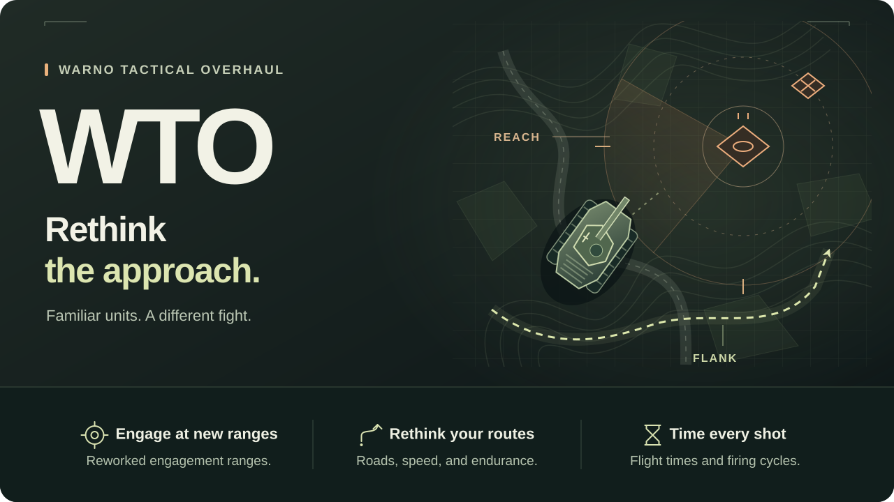

# WARNO Tactical Overhaul

Reconsider the route. The enemy can reach further now.

[**Play on Steam**](https://steamcommunity.com/sharedfiles/filedetails/?id=3387658237) · [Customize WTO](GUIDE.md) · [Download the installer](https://github.com/Yokaiste/WTO/releases/latest) · [YSM Community](https://discord.gg/33Sqn6dTjf)

WTO changes where fights begin and how units move through them. Reworked ranges, sight, and weapon timing give familiar WARNO units a different set of decisions on the battlefield.

## Plan around the new reach

| What changes                                        | What to reconsider                                         |
| --------------------------------------------------- | ---------------------------------------------------------- |
| Ammunition and missile engagement ranges            | Cover, spacing, and how far a position can threaten you    |
| Ground movement, road bonuses, and fuel endurance   | Approach routes and the time it takes to reinforce a fight |
| Vision and support radii                            | Recon placement and where support units can help           |
| Missile flight, projectile speed, and firing cycles | When to expose a unit and when to move it again            |

Artillery behavior, smoke salvos, and selected weapon rules also change. Charging down the same road as last time remains an option. It may be a shorter game.

## Play it alone or with YSM

Use WTO on its own for its tactical balance changes. Pair it with [Yokaiste's Sandbox Mod](https://github.com/Yokaiste/YSM) for expanded divisions, sandbox units, and match options under WTO's balance rules.

For **WTO x ANY MOD**, [Yuri's WARNO Toolkit](https://github.com/dary1337/yuri-warno-toolkit) can prepare local combinations with other mods. Compatibility varies; a combination still needs testing against the mods you choose.

## Get into a match

Subscribe on Steam, then activate the downloaded mod in WARNO's Mod Center. Use matching mod builds for multiplayer.

The [customization guide](GUIDE.md) covers installing a local copy and adjusting a few useful settings. The installer includes YSM; the guide also shows how to build WTO alone. WTO uses [Yokaiste's Mod Builder](https://github.com/Yokaiste/YMB) to apply its rules to your game data.

## Credits and license

WTO's owner and original author is [ShadowofChernobyl](https://steamcommunity.com/id/ShadowofCherno/). This repository uses the [MIT License](LICENSE); retain its copyright and license notice when sharing it. See [NOTICE](NOTICE) for attribution.

YSM has [separate terms](https://github.com/Yokaiste/YSM/blob/master/LICENSE), as do YMB, WARNO, and other included material. WTO's license does not change those permissions.

---

Want to keep track of this project? [Star the WTO repository](https://github.com/Yokaiste/WTO).
